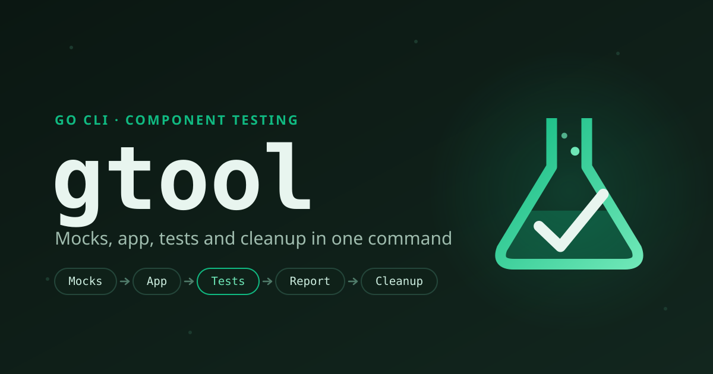
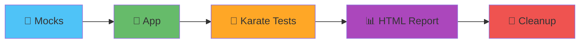
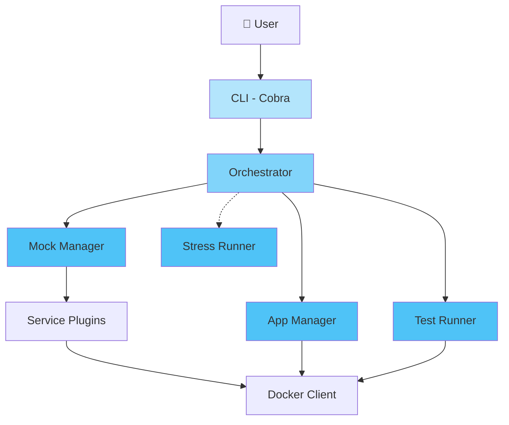

<p align="center">
  
</p>

# GTOOL - Component Testing Orchestrator

> 🌐 **Language:** English · [Español](docs/readme/README.es.md)
>
> 📚 **Documentation:** [oswaldom-code.github.io/gtool](https://oswaldom-code.github.io/gtool/)

<div align="center">

[](https://go.dev/)


[](LICENSE)

**A Go CLI to orchestrate microservice component tests: spin up mocks, launch the app, run the tests and clean everything up — with a single command.**

</div>

---

## 🎯 What GTOOL does

GTOOL is a CLI orchestrator for **component testing** of microservices. It stands up a service's external dependencies as mocks, launches the service, runs its test suite against that isolated environment, and tears everything down — reproducibly, with a single command. It replaces hand-managed Docker setups and ad-hoc shell scripts with one typed Go binary featuring structured logging, strict config validation and a plugin architecture.



**A single `gtool test` runs the full pipeline:**

1. **Mocks** — starts the third-party dependencies in Docker. 10 built-in services: PostgreSQL, MySQL, MongoDB, Redis, Kafka, Pub/Sub, Couchbase, GCS, Floci (AWS: S3, SQS) and Mountebank.
2. **App** — launches the service under test, as a Docker image or as native binaries.
3. **Tests** — runs the Karate (backend API) suite against the app and its mocks.
4. **Report** — generates the Karate HTML report and can open it in the browser.
5. **Cleanup** — always tears down app and mocks, even on failure or Ctrl-C.

Beyond the pipeline, GTOOL also:

- **Stress-tests the app** (`gtool stress`) — reuses mocks → app, ramps the load over targets resolved from an OpenAPI contract, reports the degradation and breaking points and gates CI on a minimum sustained load.
- **Runs unit tests** (`gtool unit`) — mock generation + Ginkgo.
- **Drives each phase on its own** — `gtool services`, `gtool app`, `gtool test karate`.

New mock services plug in through the `ServicePlugin` interface.

---

## 🚀 Installation

```bash
# Latest release
go install github.com/oswaldom-code/gtool/cmd/gtool@latest

# Karate launcher image (not published; build it once per machine)
docker build -t gtool/test-launcher-back:latest \
  https://github.com/oswaldom-code/gtool.git#v1.0.0:test-launcher

# From source
git clone https://github.com/oswaldom-code/gtool.git && cd gtool
make build              # builds ./bin/gtool with version, commit and build date
./bin/gtool version --full
make install            # copies the binary to $(go env GOPATH)/bin
make test-launcher-image  # builds the Karate launcher image
```

`go install` does not inject build metadata, so `gtool version --full` reports commit `dev`; build with `make build` when you need it (it is also recorded in the stress reports).

> ⚠️ **`make install` copies to `$GOPATH/bin` (`~/go/bin`).** If your terminal can't find `gtool` after installing, that directory is not on your `PATH`. Add it:
> ```bash
> echo 'export PATH="$PATH:$GOPATH/bin"' >> ~/.zshrc   # or ~/.bashrc
> source ~/.zshrc && rehash
> ```

**Requirements:** Go 1.26+, Docker, Make.

**AI coding agents:** the repository ships an [Agent Skill](skills/gtool/SKILL.md) that teaches agents (Claude Code, Codex, Cursor, Gemini CLI and others) to install gtool and wire it into a service: `npx skills add oswaldom-code/gtool --skill gtool`.

---

## ⚡ Quick Start

```bash
# 1. Validate the repo configuration
gtool config validate --config component-config.yml

# 2. Start the mocks only
gtool services up
gtool services status
gtool services down

# 3. Full pipeline (mocks → app → tests → cleanup)
gtool test
```

GTOOL looks for `./component-config.yml` by default. Use `--config <file>` for another one.

---

## 📖 Commands

Every command accepts `--config <file>`, `--log-level debug|info|warn|error` (also `GTOOL_LOG_LEVEL` or `observability.log-level`) and `--verbose` (debug). Output uses symbols only on an interactive terminal; with a pipe, `NO_COLOR` or `CI` it is plain text. `gtool completion <shell>` generates shell autocompletion.

### `gtool config` — configuration
```bash
gtool config validate --config component-config.yml   # validates the schema
gtool config show --format yaml                        # prints the resolved config
gtool config show --format json
```

### `gtool services` (alias `s`) — third-party mocks
```bash
gtool services up                     # starts every mock in the config
gtool s up postgresql kafka           # starts specific services
gtool s up --stable                   # fixed-contract mocks seeded from test/component/mocks-data
gtool s status                        # services status
gtool s logs postgresql --tail 200 -f # logs of a service; -f follows one service until Ctrl-C (--all for every service)
gtool s down                          # stops all (only containers without a run ID; --all-runs for every run)
```

### `gtool app` — application under test
```bash
gtool app start --docker-image myapp:latest --port 8080 --env LOG_LEVEL=debug
gtool app start --native              # build-config.yml binaries as native processes
gtool app status
gtool app logs --tail 100
gtool app restart                     # --native restarts the native binaries
gtool app stop
```

### `gtool unit` (alias `u`) — unit tests
Generates the mocks from `build-config.yml` (mockgen) and runs the suite with Ginkgo, leaving coverage and the JUnit report in `./coverage`.
```bash
gtool unit
gtool unit --skip-mocks               # runs the tests only
gtool unit --build-config build-config.yml
```

### `gtool test` — component pipeline
```bash
gtool test                            # gtool-native pipeline (public images); --tags overrides test-config.tags
gtool test --stable --tags "@smoke"   # fixed-contract mocks + native app + Karate
gtool test karate                     # Karate only (mocks and app already up, explicit ports)
gtool test karate --tags "@smoke" --reports ./out
gtool test karate --stable --no-open  # fixed-contract runner, after services up --stable + app start --native
```
`gtool test karate` reads `test-config` and the ports of the config file like `gtool test`; `--tags`, `--features` and `--reports` override it, and `--image` overrides the launcher image. `--urls-to-block` and `--no-open` only apply with `--stable`.

### `gtool stress` — stress testing
```bash
gtool stress plan --config configs/stress-example.yml   # resolved targets, no load
gtool stress --config configs/stress-example.yml        # mocks → app → load ramp → reports → cleanup
gtool stress --target-url https://staging.example.com   # remote target, skips mocks and app
```
Ramps the load in steps over targets resolved from an OpenAPI contract (Swagger 2.0 / OpenAPI 3.x) and/or an explicit `targets` list, and reports the **degradation point** (p95 over a factor of the baseline or an absolute SLO, or throughput below 90% of the requested rate) and the **breaking point** (5xx + network error rate over the threshold). Writes `stress-report.json` (stable schema for CI) and a self-contained `stress-report.html`, and exits non-zero when the sustained load is below `min-acceptable-rps`. See the [`stress-config` example](configs/stress-example.yml).

### `gtool generate` (alias `g`) / `gtool version`
```bash
gtool generate config                 # generates a sample component-config.yml
gtool version --full                  # version, git commit and build date
```

---

## 🧩 Configuration

GTOOL uses two files (`.yml` extension preferred; `.yaml` supported). `${VAR}` and `$VAR` references in values are expanded from the environment after parsing (unset variables are left as written, `$$` is a literal `$`). `gtool test` and `gtool services up` / `app start` validate the file before starting anything; `gtool test` fails when no config file is found.

### `component-config.yml` — component pipeline
```yaml
version: v1
app-technology: golang            # golang | generic
app-config:
  docker-image: myapp:latest      # the app under test runs as a container
  port: 8080                      # port the app listens on inside the container
  host-port: auto                 # free host port per run (omit = same as port)
  health-path: /health            # polled until it answers before tests run (default /)
  environment:
    DB_HOST: host.docker.internal
    DB_PORT: "${mocks.postgresql.port}"   # this run's mock port
test-launcher: test-launcher-back
test-config:
  features-path: ./test/component/features   # required by gtool test
  reports-path: ./test/component/reports
third-party:
  mocks: [postgresql, pubsub]
  mock-config:
    postgresql:
      port: auto                  # any port key (port, *-port) accepts auto
    pubsub:
      project-id: my-project
      topics: [my-topic]
      subscriptions:
        - name: my-sub
          topic: my-topic
```
Unknown `mock-config` keys, invalid ports and two port keys of one mock on the same host port are validation errors.

`--stable` mode reads Pub/Sub topics in its own layout instead:
```yaml
    pubsub:
      project-id: my-project
      topics:
        - topic-id: my-topic
          subscription-ids: [my-sub]
```

### Dynamic ports and concurrent runs
- `port: auto` (mocks) and `host-port: auto` (app) pick free host ports per run, so several `gtool test` runs share one host (e.g. a CI agent).
- `${mocks.<service>.<port-key>}`, `${app.port}` and `${app.host-port}` in `app-config.environment` are replaced with this run's values; mocks that do not set a port expose their default.
- Karate receives `GTOOL_APP_URL`, `GTOOL_<SERVICE>_PORT` and `GTOOL_<SERVICE>_{USER,PASSWORD,DATABASE}`; features use `* url appUrl` and the launcher helpers follow these ports.
- Every `gtool test` / `gtool stress` run labels and names its containers with a run ID (`GTOOL_RUN_ID`, or a generated one), so one run's teardown never touches another. Without `GTOOL_RUN_ID`, `services` and `app` commands only act on containers of no run; `--all-runs` widens them to every run.
- `auto` only works in single-invocation pipelines (`gtool test`, `gtool stress`): separate `services up` / `app start` commands cannot share allocated ports and reject it.

### `stress-config` — stress testing (for `gtool stress`)
```yaml
stress-config:
  source:
    openapi: api/swagger.yml        # Swagger 2.0 or OpenAPI 3.x
    methods: [GET]                  # default: GET only
    include-tags: [products]
    exclude-paths: ["/health"]
    headers: { Authorization: "Bearer ${STRESS_TOKEN}" }
    param-values: { productId: ["1", "2", "3"] }
    operation-overrides:
      createOrder: { body-file: test/stress/order.json, weight: 3 }
  targets: []                       # explicit targets, override spec operations
  ramp: { start-rps: 10, step-rps: 10, step-duration: 20s, max-rps: 500 }
  thresholds: { degradation-latency-factor: 2.0, degradation-p95-ms: 800, break-error-rate: 0.05 }
  min-acceptable-rps: 100
  reports-path: test/stress/reports
```

### `build-config.yml` — Go binaries and mocks (for `gtool unit`)
```yaml
version: v5
build:
  binaries:
    - name: api
      path: cmd/server/main.go
mocks:
  - source: internal/service/foo_interface.go
    filename: foo_interface.go
```

---

## 🧪 Examples

[`examples/`](examples/) holds self-contained sample apps (each with its own `go.mod`, `Dockerfile`, `component-config.yml` and Karate features) that exercise the pipeline end-to-end against one mock each:

| Example | Mock |
|---|---|
| [`postgres-app`](examples/postgres-app/) | PostgreSQL — also the `gtool stress` sample ([`configs/stress-example.yml`](configs/stress-example.yml)) |
| [`mysql-app`](examples/mysql-app/) | MySQL |
| [`mongodb-app`](examples/mongodb-app/) | MongoDB |
| [`redis-app`](examples/redis-app/) | Redis |
| [`kafka-app`](examples/kafka-app/) | Kafka |
| [`pubsub-app`](examples/pubsub-app/) | Pub/Sub |
| [`gcs-app`](examples/gcs-app/) | GCS |
| [`s3-app`](examples/s3-app/) | Floci (S3) |
| [`mountebank-app`](examples/mountebank-app/) | Mountebank (stubbed external API) |

[`examples/ci/jenkins`](examples/ci/jenkins/) runs a local Jenkins that executes the example pipelines with gtool.

---

## 🏗️ Architecture



- **Plugins** (`internal/plugin/`): `ServicePlugin` (mocks), registered in a thread-safe `plugin.Registry`; defaults and accepted keys in `internal/plugin/services/defaults.go`.
- **App** (`internal/core/app`): the app as a container (`DockerManager`) or as native processes (`nativeapp`).
- **Orchestrator** (`internal/core/orchestrator`): runs mocks → app → test phase and always tears down. The test phase is a `TestRunner`: the Karate runner for `gtool test`, the stress runner (`internal/core/stress`, vegeta + libopenapi) for `gtool stress`.
- **Typed errors** (`pkg/errors`) and **structured logging** with Zap (`pkg/logger`).

---

## 🛠️ Development

```bash
make build                # builds ./bin/gtool
make test                 # tests with -race
make test-coverage        # HTML coverage report
make lint                 # golangci-lint
make staticcheck          # staticcheck
make trivy                # dependency vulnerability scan
make fmt                  # go fmt + goimports
make test-launcher-image  # builds the Karate launcher image
make release              # cross-platform binaries in bin/releases
make clean                # cleans artifacts
make help                 # lists every target
```

**Standards:** minimum 80% coverage for new code (95%+ for config/orchestration), Ginkgo/Gomega or table-driven tests, errors from `pkg/errors`, structured logging with Zap, conventional commits.

Integration tests (require Docker) per plugin:
```bash
go test -tags=integration ./internal/plugin/services/...
```

---

## ⚠️ Known limitations

- **App→mock networking (native `gtool test`).** The default pipeline runs the app as a bridge-network container while the mocks publish their ports on the host, so a containerized app cannot reach a mock at `localhost`. gtool maps `host.docker.internal` to the host gateway on the app container, so point the app at `host.docker.internal:<mock port>` on Linux and Docker Desktop alike. On Linux hosts with a firewall that drops incoming traffic from the Docker bridge (for example ufw with its default policy), allow it with `sudo ufw allow in on docker0`. The `--stable` / `--native` path runs the app as native processes that reach the mocks over `127.0.0.1`.
- **Fixed ports for some mocks.** Mountebank imposter ports come from the imposter files and are published on the same host port (not `auto`); Couchbase's data port must stay 11210 because the cluster advertises its container ports.
- **Stress results are host-relative.** The load generator, the app and the mocks share the host, so `gtool stress` numbers are for comparing commits, not production capacity estimates; use `--target-url` for serious measurements. Container CPU/memory metrics are not collected yet.

---

## 📦 Status

Functional end-to-end pipeline: 10 mock plugins, app launcher (Docker and native), Karate runner, stress testing and orchestration with guaranteed teardown.

| Phase | Status |
|------|--------|
| 1. Foundation (CLI, config, plugins, errors, logging) | ✅ |
| 2. Mocks (10 plugins) | ✅ |
| 3. App (Docker + native) | ✅ |
| 4. Test Executor (Karate) | ✅ |
| 5. Orchestration (pipeline + teardown) | ✅ |
| Stress testing (`gtool stress`) | ✅ |
| 6–7. Advanced features, docs/release | 🔄 |

---
