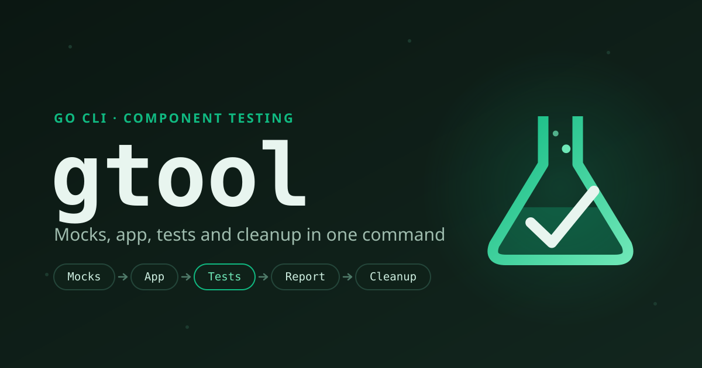
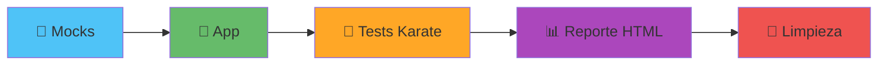
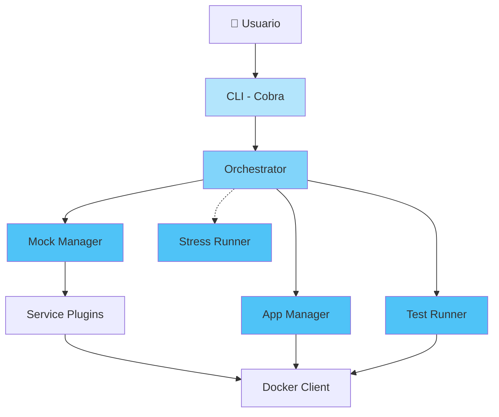

<p align="center">
  
</p>

# GTOOL - Component Testing Orchestrator

> 🌐 **Idioma:** Español · [English](../../README.md)
>
> 📚 **Documentación:** [oswaldom-code.github.io/gtool/es](https://oswaldom-code.github.io/gtool/es/)

<div align="center">

[](https://go.dev/)


[](../../LICENSE)

**CLI en Go para orquestar pruebas de componente de microservicios: levanta mocks, lanza la app, corre los tests y limpia todo — con un solo comando.**

</div>

---

## 🎯 Qué hace GTOOL

GTOOL es un orquestador CLI para **pruebas de componente** de microservicios. Levanta las dependencias externas de un servicio como mocks, lanza el servicio, ejecuta su suite de tests contra ese entorno aislado y lo derriba todo — de forma reproducible y con un solo comando. Reemplaza configuraciones de Docker gestionadas a mano y scripts de shell ad-hoc por un único binario en Go, tipado, con logs estructurados, validación estricta de configuración y una arquitectura de plugins.



**Un solo `gtool test` corre el pipeline completo:**

1. **Mocks** — levanta las dependencias de terceros en Docker. 10 servicios incorporados: PostgreSQL, MySQL, MongoDB, Redis, Kafka, Pub/Sub, Couchbase, GCS, Floci (AWS: S3, SQS) y Mountebank.
2. **App** — lanza el servicio bajo prueba, como imagen Docker o como binarios nativos.
3. **Tests** — ejecuta la suite Karate (API backend) contra la app y sus mocks.
4. **Reporte** — genera el reporte HTML de Karate y puede abrirlo en el navegador.
5. **Limpieza** — derriba app y mocks siempre, incluso ante fallos o Ctrl-C.

Además del pipeline, GTOOL también:

- **Hace pruebas de estrés** (`gtool stress`) — reutiliza mocks → app, sube la carga sobre targets resueltos desde un contrato OpenAPI, reporta los puntos de degradación y ruptura y actúa como gate de CI con una carga mínima sostenida.
- **Corre tests unitarios** (`gtool unit`) — generación de mocks + Ginkgo.
- **Ejecuta cada fase por separado** — `gtool services`, `gtool app`, `gtool test karate`.

Los nuevos servicios mock se conectan mediante la interfaz `ServicePlugin`.

---

## 🚀 Instalación

```bash
# Última release
go install github.com/oswaldom-code/gtool/cmd/gtool@latest

# Imagen del launcher de Karate (no se publica; constrúyela una vez por máquina)
docker build -t gtool/test-launcher-back:latest \
  https://github.com/oswaldom-code/gtool.git#v1.0.0:test-launcher

# Desde el código fuente
git clone https://github.com/oswaldom-code/gtool.git && cd gtool
make build              # compila ./bin/gtool con versión, commit y fecha de build
./bin/gtool version --full
make install            # copia el binario a $(go env GOPATH)/bin
make test-launcher-image  # construye la imagen del launcher de Karate
```

`go install` no inyecta los metadatos de build, así que `gtool version --full` muestra el commit `dev`; compila con `make build` cuando los necesites (también se registran en los reportes de estrés).

> ⚠️ **`make install` copia a `$GOPATH/bin` (`~/go/bin`).** Si tu terminal no encuentra `gtool` tras instalar, ese directorio no está en tu `PATH`. Agrégalo:
> ```bash
> echo 'export PATH="$PATH:$GOPATH/bin"' >> ~/.zshrc   # o ~/.bashrc
> source ~/.zshrc && rehash
> ```

**Requisitos:** Go 1.26+, Docker, Make.

**Agentes de IA:** el repositorio incluye una [Agent Skill](../../skills/gtool/SKILL.md) que enseña a los agentes (Claude Code, Codex, Cursor, Gemini CLI y otros) a instalar gtool e integrarlo en un servicio: `npx skills add oswaldom-code/gtool --skill gtool`.

---

## ⚡ Quick Start

```bash
# 1. Validar la configuración del repo
gtool config validate --config component-config.yml

# 2. Levantar solo los mocks
gtool services up
gtool services status
gtool services down

# 3. Pipeline completo (mocks → app → tests → limpieza)
gtool test
```

GTOOL busca por defecto `./component-config.yml`. Usa `--config <archivo>` para otro.

---

## 📖 Comandos

Todos los comandos aceptan `--config <archivo>`, `--log-level debug|info|warn|error` (también `GTOOL_LOG_LEVEL` u `observability.log-level`) y `--verbose` (debug). La salida usa símbolos solo en una terminal interactiva; con un pipe, `NO_COLOR` o `CI` es texto plano. `gtool completion <shell>` genera el autocompletado de la shell.

### `gtool config` — configuración
```bash
gtool config validate --config component-config.yml   # valida el esquema
gtool config show --format yaml                        # imprime la config resuelta
gtool config show --format json
```

### `gtool services` (alias `s`) — mocks de terceros
```bash
gtool services up                     # levanta todos los mocks de la config
gtool s up postgresql kafka           # levanta servicios específicos
gtool s up --stable                   # mocks de contrato fijo sembrados desde test/component/mocks-data
gtool s status                        # estado de los servicios
gtool s logs postgresql --tail 200 -f # logs de un servicio; -f sigue un servicio hasta Ctrl-C (--all para todos)
gtool s down                          # detiene todos (solo contenedores sin run ID; --all-runs para todas las ejecuciones)
```

### `gtool app` — aplicación bajo prueba
```bash
gtool app start --docker-image myapp:latest --port 8080 --env LOG_LEVEL=debug
gtool app start --native              # binarios de build-config.yml como procesos nativos
gtool app status
gtool app logs --tail 100
gtool app restart                     # --native reinicia los binarios nativos
gtool app stop
```

### `gtool unit` (alias `u`) — tests unitarios
Genera los mocks de `build-config.yml` (mockgen) y corre el suite con Ginkgo, dejando cobertura y reporte JUnit en `./coverage`.
```bash
gtool unit
gtool unit --skip-mocks               # solo corre los tests
gtool unit --build-config build-config.yml
```

### `gtool test` — pipeline de componente
```bash
gtool test                            # pipeline nativo de gtool (imágenes públicas); --tags sobrescribe test-config.tags
gtool test --stable --tags "@smoke"   # mocks de contrato fijo + app nativa + Karate
gtool test karate                     # solo Karate (mocks y app ya levantados, puertos explícitos)
gtool test karate --tags "@smoke" --reports ./out
gtool test karate --stable --no-open  # runner de contrato fijo, tras services up --stable + app start --native
```
`gtool test karate` lee `test-config` y los puertos del archivo de configuración igual que `gtool test`; `--tags`, `--features` y `--reports` los sobrescriben, e `--image` sobrescribe la imagen del launcher. `--urls-to-block` y `--no-open` solo aplican con `--stable`.

### `gtool stress` — pruebas de estrés
```bash
gtool stress plan --config configs/stress-example.yml   # targets resueltos, sin carga
gtool stress --config configs/stress-example.yml        # mocks → app → rampa de carga → reportes → cleanup
gtool stress --target-url https://staging.example.com   # target remoto, omite mocks y app
```
Sube la carga por escalones sobre los targets resueltos desde un contrato OpenAPI (Swagger 2.0 / OpenAPI 3.x) y/o una lista explícita `targets`, y reporta el **punto de degradación** (p95 por encima de un factor del baseline o de un SLO absoluto, o throughput por debajo del 90% del rate pedido) y el **punto de ruptura** (tasa de errores 5xx + red por encima del umbral). Escribe `stress-report.json` (schema estable para CI) y un `stress-report.html` autocontenido, y termina con código distinto de cero cuando la carga sostenida queda por debajo de `min-acceptable-rps`. Ver el [ejemplo de `stress-config`](../../configs/stress-example.yml).

### `gtool generate` (alias `g`) / `gtool version`
```bash
gtool generate config                 # genera un component-config.yml de ejemplo
gtool version --full                  # versión, commit de git y fecha de build
```

---

## 🧩 Configuración

GTOOL usa dos archivos (extensión `.yml` preferida; `.yaml` soportado). Las referencias `${VAR}` y `$VAR` en los valores se expanden desde el entorno tras parsear (las variables no definidas quedan como están, `$$` es un `$` literal). `gtool test` y `gtool services up` / `app start` validan el archivo antes de arrancar nada; `gtool test` falla si no encuentra un archivo de config.

### `component-config.yml` — pipeline de componente
```yaml
version: v1
app-technology: golang            # golang | generic
app-config:
  docker-image: myapp:latest      # la app bajo prueba corre como contenedor
  port: 8080                      # puerto en el que escucha la app dentro del contenedor
  host-port: auto                 # puerto de host libre por ejecución (omitido = igual que port)
  health-path: /health            # se consulta hasta que responde antes de los tests (por defecto /)
  environment:
    DB_HOST: host.docker.internal
    DB_PORT: "${mocks.postgresql.port}"   # puerto del mock en esta ejecución
test-launcher: test-launcher-back
test-config:
  features-path: ./test/component/features   # obligatorio para gtool test
  reports-path: ./test/component/reports
third-party:
  mocks: [postgresql, pubsub]
  mock-config:
    postgresql:
      port: auto                  # cualquier clave de puerto (port, *-port) acepta auto
    pubsub:
      project-id: my-project
      topics: [my-topic]
      subscriptions:
        - name: my-sub
          topic: my-topic
```
Las claves desconocidas en `mock-config`, los puertos inválidos y dos claves de puerto de un mismo mock en el mismo puerto de host son errores de validación.

El modo `--stable` lee los topics de Pub/Sub con su propio formato:
```yaml
    pubsub:
      project-id: my-project
      topics:
        - topic-id: my-topic
          subscription-ids: [my-sub]
```

### Puertos dinámicos y ejecuciones concurrentes
- `port: auto` (mocks) y `host-port: auto` (app) eligen puertos de host libres por ejecución, así varias ejecuciones de `gtool test` comparten un host (p. ej. un agente de CI).
- `${mocks.<servicio>.<clave-de-puerto>}`, `${app.port}` y `${app.host-port}` en `app-config.environment` se reemplazan con los valores de la ejecución; los mocks que no fijan puerto exponen su valor por defecto.
- Karate recibe `GTOOL_APP_URL`, `GTOOL_<SERVICIO>_PORT` y `GTOOL_<SERVICIO>_{USER,PASSWORD,DATABASE}`; los features usan `* url appUrl` y los helpers del launcher siguen esos puertos.
- Cada ejecución de `gtool test` / `gtool stress` etiqueta y nombra sus contenedores con un run ID (`GTOOL_RUN_ID`, o uno generado), así el teardown de una nunca toca a otra. Sin `GTOOL_RUN_ID`, los comandos `services` y `app` solo actúan sobre contenedores sin ejecución; `--all-runs` los amplía a todas.
- `auto` solo funciona en pipelines de una sola invocación (`gtool test`, `gtool stress`): los comandos separados `services up` / `app start` no pueden compartir los puertos asignados y lo rechazan.

### `stress-config` — pruebas de estrés (para `gtool stress`)
```yaml
stress-config:
  source:
    openapi: api/swagger.yml        # Swagger 2.0 u OpenAPI 3.x
    methods: [GET]                  # por defecto: solo GET
    include-tags: [products]
    exclude-paths: ["/health"]
    headers: { Authorization: "Bearer ${STRESS_TOKEN}" }
    param-values: { productId: ["1", "2", "3"] }
    operation-overrides:
      createOrder: { body-file: test/stress/order.json, weight: 3 }
  targets: []                       # targets explícitos, reemplazan operaciones del spec
  ramp: { start-rps: 10, step-rps: 10, step-duration: 20s, max-rps: 500 }
  thresholds: { degradation-latency-factor: 2.0, degradation-p95-ms: 800, break-error-rate: 0.05 }
  min-acceptable-rps: 100
  reports-path: test/stress/reports
```

### `build-config.yml` — binarios y mocks de Go (para `gtool unit`)
```yaml
version: v5
build:
  binaries:
    - name: api
      path: cmd/server/main.go
mocks:
  - source: internal/service/foo_interface.go
    filename: foo_interface.go
```

---

## 🧪 Ejemplos

[`examples/`](../../examples/) contiene apps de ejemplo autocontenidas (cada una con su `go.mod`, `Dockerfile`, `component-config.yml` y features de Karate) que ejercitan el pipeline end-to-end contra un mock cada una:

| Ejemplo | Mock |
|---|---|
| [`postgres-app`](../../examples/postgres-app/) | PostgreSQL — también el ejemplo de `gtool stress` ([`configs/stress-example.yml`](../../configs/stress-example.yml)) |
| [`mysql-app`](../../examples/mysql-app/) | MySQL |
| [`mongodb-app`](../../examples/mongodb-app/) | MongoDB |
| [`redis-app`](../../examples/redis-app/) | Redis |
| [`kafka-app`](../../examples/kafka-app/) | Kafka |
| [`pubsub-app`](../../examples/pubsub-app/) | Pub/Sub |
| [`gcs-app`](../../examples/gcs-app/) | GCS |
| [`s3-app`](../../examples/s3-app/) | Floci (S3) |
| [`mountebank-app`](../../examples/mountebank-app/) | Mountebank (API externa stubeada) |

[`examples/ci/jenkins`](../../examples/ci/jenkins/) levanta un Jenkins local que ejecuta los pipelines de los ejemplos con gtool.

---

## 🏗️ Arquitectura



- **Plugins** (`internal/plugin/`): `ServicePlugin` (mocks), registrados en un `plugin.Registry` thread-safe; valores por defecto y claves aceptadas en `internal/plugin/services/defaults.go`.
- **App** (`internal/core/app`): la app como contenedor (`DockerManager`) o como procesos nativos (`nativeapp`).
- **Orquestador** (`internal/core/orchestrator`): ejecuta mocks → app → fase de test y siempre hace teardown. La fase de test es un `TestRunner`: el runner de Karate para `gtool test` y el runner de estrés (`internal/core/stress`, vegeta + libopenapi) para `gtool stress`.
- **Errores tipados** (`pkg/errors`) y **logging estructurado** con Zap (`pkg/logger`).

---

## 🛠️ Desarrollo

```bash
make build                # compila ./bin/gtool
make test                 # tests con -race
make test-coverage        # reporte HTML de cobertura
make lint                 # golangci-lint
make staticcheck          # staticcheck
make trivy                # escaneo de vulnerabilidades de dependencias
make fmt                  # go fmt + goimports
make test-launcher-image  # construye la imagen del launcher de Karate
make release              # binarios multiplataforma en bin/releases
make clean                # limpia artefactos
make help                 # lista todos los targets
```

**Estándares:** mínimo 80% de cobertura para código nuevo (95%+ en config/orquestación), tests con Ginkgo/Gomega o table-driven, errores de `pkg/errors`, logging estructurado con Zap, conventional commits.

Tests de integración (requieren Docker) por plugin:
```bash
go test -tags=integration ./internal/plugin/services/...
```

---

## ⚠️ Limitaciones conocidas

- **Puertos fijos en algunos mocks.** Los puertos de los imposters de Mountebank salen de sus archivos y se publican en el mismo puerto de host (no `auto`); el puerto de datos de Couchbase debe seguir en 11210 porque el cluster anuncia los puertos del contenedor.
- **Los resultados de estrés son relativos al host.** El generador de carga, la app y los mocks comparten host, así que los números de `gtool stress` sirven para comparar commits, no para estimar capacidad en producción; usa `--target-url` para mediciones serias. Aún no se recogen métricas de CPU/memoria de los contenedores.

---

## 📦 Estado

Pipeline funcional end-to-end: 10 plugins de mock, lanzador de app (Docker y nativo), runner Karate, pruebas de estrés y orquestación con teardown garantizado.

| Fase | Estado |
|------|--------|
| 1. Fundamentos (CLI, config, plugins, errores, logging) | ✅ |
| 2. Mocks (10 plugins) | ✅ |
| 3. App (Docker + nativo) | ✅ |
| 4. Test Executor (Karate) | ✅ |
| 5. Orquestación (pipeline + teardown) | ✅ |
| Pruebas de estrés (`gtool stress`) | ✅ |
| 6–7. Features avanzadas, docs/release | 🔄 |

---

