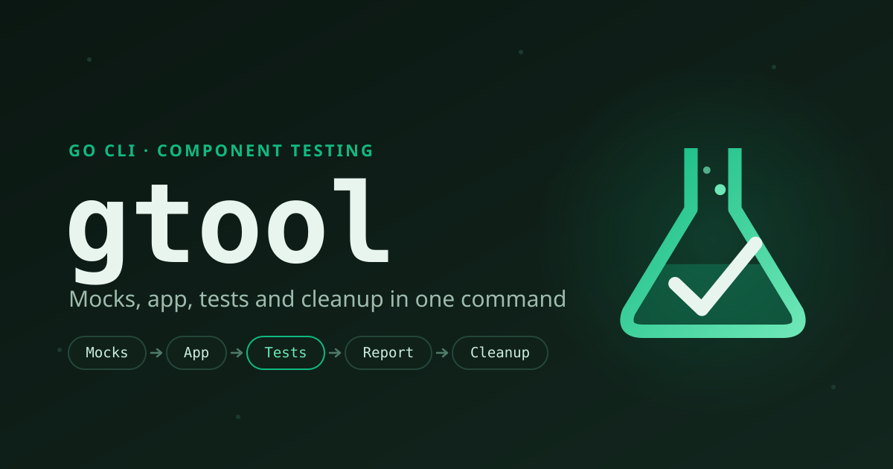

# Tests de componente en un solo comando { .gt-sr-only }

**gtool** es una CLI en Go que ejecuta los tests de componente de un microservicio de
principio a fin: levanta las dependencias del servicio como mocks, arranca el servicio,
ejecuta su suite de tests contra ese entorno aislado y lo limpia todo, incluso si algo
falla o pulsas Ctrl-C.

[Empezar](getting-started/installation.md){ .md-button .md-button--primary }
[Ver en GitHub](https://github.com/oswaldom-code/gtool){ .md-button }

## Instalación

```sh
go install github.com/oswaldom-code/gtool/cmd/gtool@latest
docker build -t gtool/test-launcher-back:latest \
  https://github.com/oswaldom-code/gtool.git#v1.0.0:test-launcher
```

Requiere Go 1.26+ y un daemon de Docker en ejecución. El segundo comando construye la
imagen del launcher de Karate una vez por máquina; no se publica en ningún registro.

## El pipeline

Un solo `gtool test` ejecuta todas las fases en orden. Todo lo que se haya levantado
se limpia siempre.

<div class="gt-pipeline">
  <span class="step">Mocks</span><span class="arr">→</span>
  <span class="step">App</span><span class="arr">→</span>
  <span class="step hot">Tests</span><span class="arr">→</span>
  <span class="step">Reporte</span><span class="arr">→</span>
  <span class="step end">Limpieza</span>
</div>

`gtool stress` reutiliza los mismos mocks y la misma app, y sustituye la fase de tests
por una rampa de carga que encuentra dónde se degrada el servicio y dónde se rompe.

## Inicio rápido

=== "component-config.yml"

    ```yaml
    version: v1
    app-technology: golang
    app-config:
      docker-image: users-api:latest
      port: 8080
      host-port: auto
      health-path: /health
      environment:
        DB_HOST: host.docker.internal
        DB_PORT: "${mocks.postgresql.port}"
    test-launcher: test-launcher-back
    test-config:
      features-path: ./test/component/features
      reports-path: ./test/component/reports
    third-party:
      mocks: [postgresql]
      mock-config:
        postgresql:
          port: auto
          scripts-path: ./test/component/mocks-data/postgresql
    ```

=== "Ejecutar"

    ```sh
    gtool config validate        # strict schema validation
    gtool test                   # mocks → app → Karate → cleanup
    gtool stress plan            # targets a stress run would hit
    ```

## Qué incluye

<div class="grid cards" markdown>

-   **10 servicios mock**

    PostgreSQL, MySQL, MongoDB, Redis, Kafka, Pub/Sub, Couchbase, GCS, Floci (S3,
    SQS) y Mountebank, cargados con tus fixtures.
    [Más información](guides/mocks.md)

-   **Ejecutor de tests Karate**

    Ejecuta las features de tu API backend en un contenedor sobre la red del host y
    te devuelve el reporte HTML. [Más información](guides/pipeline.md)

-   **Pruebas de estrés**

    Targets a partir de tu contrato OpenAPI, una rampa de carga escalonada, puntos de
    degradación y de ruptura, y un gate para CI. [Más información](guides/stress.md)

-   **Limpieza garantizada**

    La app y los mocks se detienen en orden inverso tanto si todo va bien como si
    falla o pulsas Ctrl-C. Sin contenedores huérfanos.
    [Más información](reference/architecture.md)

-   **Configuración estricta**

    Un único archivo YAML, validado antes de arrancar nada, con expansión de `${VAR}`.
    [Más información](reference/configuration.md)

-   **Ejecuciones concurrentes**

    `port: auto` elige puertos libres del host en cada ejecución y cada ejecución
    etiqueta sus propios contenedores, así que varios pipelines comparten un agente
    de CI. [Más información](guides/pipeline.md)

-   **Fase a fase**

    Controla cada fase por separado (`gtool services`, `gtool app`,
    `gtool test karate`) o ejecuta tests unitarios con `gtool unit`.
    [Más información](reference/cli.md)

</div>
