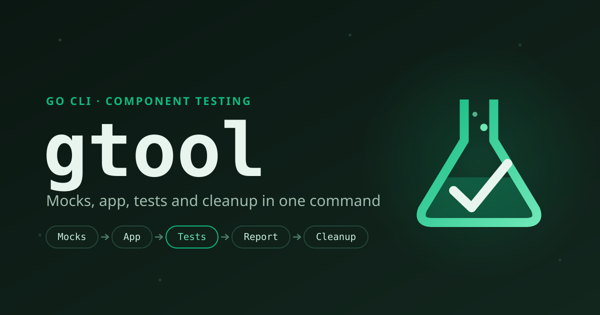

# Component tests in one command { .gt-sr-only }

**gtool** is a Go CLI that runs the component tests of a microservice end to end: it
starts the service's dependencies as mocks, launches the service, runs its test suite
against that isolated environment and tears everything down — even on failure or
Ctrl-C.

[Get started](getting-started/installation.md){ .md-button .md-button--primary }
[View on GitHub](https://github.com/oswaldom-code/gtool){ .md-button }

## Install

```sh
go install github.com/oswaldom-code/gtool/cmd/gtool@latest
docker build -t gtool/test-launcher-back:latest \
  https://github.com/oswaldom-code/gtool.git#v1.0.0:test-launcher
```

Requires Go 1.26+ and a running Docker daemon. The second command builds the Karate
launcher image once per machine; it is not published to a registry.

## The pipeline

One `gtool test` runs every phase in order. Whatever was started is always cleaned
up.

<div class="gt-pipeline">
  <span class="step">Mocks</span><span class="arr">→</span>
  <span class="step">App</span><span class="arr">→</span>
  <span class="step hot">Tests</span><span class="arr">→</span>
  <span class="step">Report</span><span class="arr">→</span>
  <span class="step end">Cleanup</span>
</div>

`gtool stress` reuses the same mocks and app and swaps the test phase for a load ramp
that finds where the service degrades and where it breaks.

## Quickstart

=== "component-config.yml"

    ```yaml
    version: v1
    app-technology: golang
    app-config:
      docker-image: users-api:latest
      port: 8080
      host-port: auto
      health-path: /health
      environment:
        DB_HOST: host.docker.internal
        DB_PORT: "${mocks.postgresql.port}"
    test-launcher: test-launcher-back
    test-config:
      features-path: ./test/component/features
      reports-path: ./test/component/reports
    third-party:
      mocks: [postgresql]
      mock-config:
        postgresql:
          port: auto
          scripts-path: ./test/component/mocks-data/postgresql
    ```

=== "Run"

    ```sh
    gtool config validate        # strict schema validation
    gtool test                   # mocks → app → Karate → cleanup
    gtool stress plan            # targets a stress run would hit
    ```

## What's in the box

<div class="grid cards" markdown>

-   **10 mock services**

    PostgreSQL, MySQL, MongoDB, Redis, Kafka, Pub/Sub, Couchbase, GCS, Floci (S3,
    SQS) and Mountebank — seeded from your fixtures.
    [Learn more](guides/mocks.md)

-   **Karate test runner**

    Runs your backend API features in a container on the host network and hands
    the HTML report back to you. [Learn more](guides/pipeline.md)

-   **Stress testing**

    Targets from your OpenAPI contract, a stepped load ramp, degradation and
    breaking points, and a CI gate. [Learn more](guides/stress.md)

-   **Guaranteed teardown**

    App and mocks are stopped in reverse order on success, failure or Ctrl-C. No
    orphan containers. [Learn more](reference/architecture.md)

-   **Strict configuration**

    One YAML file, validated before anything starts, with `${VAR}` expansion.
    [Learn more](reference/configuration.md)

-   **Concurrent runs**

    `port: auto` picks free host ports per run and every run labels its own
    containers, so several pipelines share one CI agent.
    [Learn more](guides/pipeline.md)

-   **Phase by phase**

    Drive each phase on its own — `gtool services`, `gtool app`,
    `gtool test karate` — or run unit tests with `gtool unit`.
    [Learn more](reference/cli.md)

</div>
