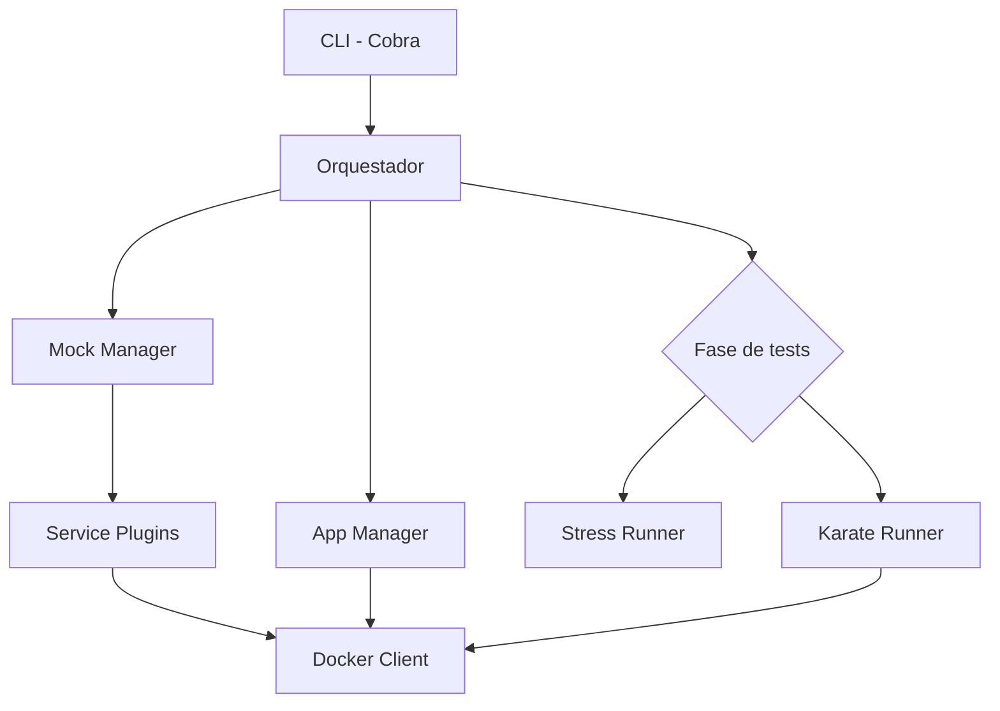

# Arquitectura

gtool es un único binario de Go. La CLI (Cobra) construye un orquestador que controla
tres gestores de fase; el acceso a Docker pasa por un único wrapper sobre el Docker SDK.



## Orquestador

`internal/core/orchestrator` ejecuta mocks → app → fase de tests. La fase de tests es
cualquier `TestRunner`:

```go
type TestRunner interface {
    Run(ctx context.Context, cfg *config.Config) (*plugin.TestResult, error)
}
```

`gtool test` conecta el runner de Karate (`internal/core/test`); `gtool stress` conecta
el runner de estrés (`internal/core/stress`). El orquestador registra lo que ha
levantado y, en una limpieza diferida con un contexto nuevo, detiene la app y después
los mocks, de modo que la limpieza también ocurre ante errores y cancelaciones.

## Servicios mock

Cada mock implementa `ServicePlugin` (`internal/plugin/interface.go`) y se registra en
un `plugin.Registry` thread-safe. El gestor de mocks arranca los plugins configurados,
espera a que estén listos y los carga con datos. Los plugins leen su `mock-config` a
través de `internal/plugin/services/svcconfig`. Añadir un servicio consiste en
implementar la interfaz, registrarlo en `internal/plugin/services/init.go` y declarar
sus puertos por defecto y sus claves aceptadas en `DefaultPorts()` y `ConfigKeys()`
(`internal/plugin/services/defaults.go`), que alimentan el validador, los puertos
`auto` y el entorno `GTOOL_*` de los tests.

## Aplicación bajo prueba

`internal/core/app` ejecuta la app como un contenedor etiquetado (`DockerManager`) y
sondea su `health-path`. `internal/core/app/nativeapp` lanza los binarios de
`build-config.yml` como procesos nativos para `--native` / `--stable`.

## Runner de estrés

- **Resolver**: lee Swagger 2.0 y OpenAPI 3.x con
  [libopenapi](https://github.com/pb33f/libopenapi), aplica filtros, valores de
  parámetros y overrides, y genera bodies a partir de los esquemas.
- **Engine**: genera la carga en el propio proceso con
  [vegeta](https://github.com/tsenart/vegeta), un ataque a tasa constante por etapa
  sobre un cliente keep-alive compartido, con round-robin ponderado entre targets.
- **Detector**: encuentra los puntos de degradación y de ruptura a partir de las
  métricas por etapa.
- **Report**: JSON con un esquema estable, una página HTML autocontenida y un resumen
  en la terminal.

## Modo estable

`gtool test --stable` compone sus propios paquetes en lugar del orquestador:
`internal/core/mock/stablemocks` (mocks de contrato fijo), `internal/core/app/nativeapp`
e `internal/core/test/stablekarate` (el contrato heredado de Karate).

## Aspectos transversales

- **Errores tipados** (`pkg/errors`): cada error lleva un código como
  `ERR_CONFIG_INVALID` o `ERR_TEST_FAILED`.
- **Logging estructurado** con Zap (`pkg/logger`).
- **Configuración estricta** (`internal/core/config`): loader con expansión de
  variables de entorno y un validador estricto.
- **Puertos** (`internal/core/ports`): resuelve los puertos `auto` y los
  placeholders `${mocks.*}` / `${app.*}` de cada ejecución.
- **Run IDs** (`internal/infra/docker/runid.go`): etiqueta y nombra los contenedores
  de cada ejecución para que las ejecuciones concurrentes nunca se pisen.
- **Readiness** (`internal/core/readiness`): espera al `health-path` de la app
  antes de los tests.
- **Carga de config en la CLI** (`internal/cli/cliconfig`): una sola política
  para archivos de config ausentes o inválidos en todos los comandos.
- **Salida de terminal** (`internal/infra/termout`): símbolos en una terminal
  interactiva, texto plano con un pipe, `NO_COLOR` o `CI`.
