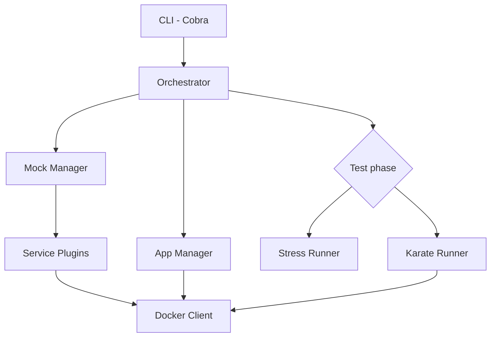

# Architecture

gtool is a single Go binary. The CLI (Cobra) builds an orchestrator that drives
three phase managers; Docker access goes through one wrapper around the Docker SDK.



## Orchestrator

`internal/core/orchestrator` runs mocks → app → test phase. The test phase is any
`TestRunner`:

```go
type TestRunner interface {
    Run(ctx context.Context, cfg *config.Config) (*plugin.TestResult, error)
}
```

`gtool test` plugs in the Karate runner (`internal/core/test`); `gtool stress` plugs
in the stress runner (`internal/core/stress`). The orchestrator records what it
started and, in a deferred cleanup with a fresh context, stops the app and then the
mocks — so teardown also happens on errors and cancellation.

## Mock services

Each mock implements `ServicePlugin` (`internal/plugin/interface.go`) and is
registered in a thread-safe `plugin.Registry`. The mock manager starts the
configured plugins, waits for them to be ready and seeds them. Plugins read their
`mock-config` through `internal/plugin/services/svcconfig`. Adding a service
means implementing the interface, registering it in
`internal/plugin/services/init.go` and listing its default ports and accepted keys
in `DefaultPorts()` and `ConfigKeys()` (`internal/plugin/services/defaults.go`),
which drive the validator, `auto` ports and the `GTOOL_*` test environment.

## Application under test

`internal/core/app` runs the app as a labelled container (`DockerManager`) and
polls its `health-path`. `internal/core/app/nativeapp` launches the
`build-config.yml` binaries as native processes for `--native` / `--stable`.

## Stress runner

- **Resolver** — reads Swagger 2.0 and OpenAPI 3.x with
  [libopenapi](https://github.com/pb33f/libopenapi), applies filters, param values
  and overrides, and generates bodies from schemas.
- **Engine** — generates load in-process with [vegeta](https://github.com/tsenart/vegeta),
  one constant-rate attack per stage over a shared keep-alive client, with weighted
  round-robin across targets.
- **Detector** — finds the degradation and breaking points from per-stage metrics.
- **Report** — JSON with a stable schema, a self-contained HTML page and a terminal
  summary.

## Stable mode

`gtool test --stable` composes its own packages instead of the orchestrator:
`internal/core/mock/stablemocks` (fixed-contract mocks), `internal/core/app/nativeapp`
and `internal/core/test/stablekarate` (the legacy Karate contract).

## Cross-cutting

- **Typed errors** (`pkg/errors`): every error carries a code such as
  `ERR_CONFIG_INVALID` or `ERR_TEST_FAILED`.
- **Structured logging** with Zap (`pkg/logger`).
- **Strict configuration** (`internal/core/config`): loader with environment
  expansion and a strict validator.
- **Ports** (`internal/core/ports`): resolves `auto` ports and the
  `${mocks.*}` / `${app.*}` placeholders for each run.
- **Run IDs** (`internal/infra/docker/runid.go`): labels and names each run's
  containers so concurrent runs never touch each other.
- **Readiness** (`internal/core/readiness`): waits for the app's `health-path`
  before tests run.
- **CLI config loading** (`internal/cli/cliconfig`): one policy for missing or
  invalid config files across commands.
- **Terminal output** (`internal/infra/termout`): symbols on an interactive
  terminal, plain text with a pipe, `NO_COLOR` or `CI`.
